<p align="center">
  
</p>

**cbot** runs a team of always-on AI agents, **self-hosted on a single machine.**

Each bot is a [Hermes Agent](https://github.com/NousResearch/hermes-agent) with its own name, instructions, memory, routines and Linux desktop.

https://github.com/user-attachments/assets/20fdaad1-30c2-43b1-a51d-bbd270465cde

## Features

- A desktop for each bot (with Chrome, a terminal and file manager) that you can watch or take control of
- Scheduled routines and check-ins
- Group chats, and bots that message each other
- Memory you can review and prune
- Search across bots, messages, library files and folders
- A library of the files that your bots create and the files you attach
- Voice calls
- Dictation
- A phone layout you can add to your home screen as an app

## Supported providers

- Claude subscription
- ChatGPT subscription
- Grok subscription
- GitHub Copilot subscription
- Anthropic API
- OpenAI API
- Google Gemini API
- xAI API
- DeepSeek API
- OpenRouter API
- Self-hosted OpenAI-compatible server (vLLM, llama.cpp, Ollama)

## Approvals

The options in **Settings** > **Permissions** decide whether the bots ask for approval before performing an action:

- **Smart** (default) only asks if the bot's model judges the action as risky
- **Off** never asks
- **Ask** always asks

## Requirements

### Hardware

You need a **dedicated** machine:

| | Minimum | Recommended |
|---|---|---|
| CPU | x86-64 (amd64), 2 cores | 4+ cores (voice uses up to 4) |
| Memory | 4 GB (1 bot) | 2 GB + 1 GB per bot (8 GB for the default 4 bots) |
| Disk | 25 GB free | 40 GB+, since bots install software and keep files |

### Operating system

Ubuntu Server 26.04 LTS is the main target. These are tested too, and install and run the same:

| Distribution | Releases |
|---|---|
| Ubuntu | 26.04 LTS, 24.04 LTS, 22.04 LTS |
| Debian | 13 (trixie), 12 (bookworm) |

Other Ubuntu and Debian derivatives may work; the installer warns that they're untested. Other distributions (Fedora, Arch and so on) and ARM machines aren't supported.

## Quick setup

### Install

On the target machine, run:

```bash
curl -fsSL https://raw.githubusercontent.com/chriscorbell/cbot/main/scripts/install.sh | bash
```

After installation is complete, open `https://<ip-address>:8787` in your browser (accept the certificate warning), create your account, then follow the setup wizard.

cbot signs its own certificate, since browsers allow the microphone (and so voice calls) only over HTTPS. To stop the warning on a device, trust the certificate from **Settings** > **General** > **Certificate**. For an address with no warning that works from anywhere, answer yes to the installer's Tailscale question.

When a new version is out, **Update available** shows in the sidebar, and one click installs it.

[docs/RUNNING.md](docs/RUNNING.md) covers updates, settings, HTTPS, models, a forgotten password and starting over.

### Uninstall

On the target machine, run this to remove cbot and all its data (Chrome, Node.js, Docker, the desktop packages and Tailscale stay installed):

```bash
curl -fsSL https://raw.githubusercontent.com/chriscorbell/cbot/main/scripts/uninstall.sh | bash
```

## Development

[AGENTS.md](AGENTS.md) explains how the code is organized and the rules for changing it. [docs/ARCHITECTURE.md](docs/ARCHITECTURE.md) explains how it works, including turns, screens, group chats and voice. [docs/RUNNING.md](docs/RUNNING.md#development) has the development container.

### Stack

- TypeScript, Node, Hono, SQLite and zod
- React 18, Vite and zustand
- Hermes Agent for each bot's model calls, memory and tools
- TigerVNC, Chrome and noVNC for the desktops
- sherpa-onnx with Parakeet, Nemotron and Silero VAD for speech recognition, Phonon 31M for text-to-speech

## License

cbot is free software under the [GNU General Public License v3.0 or later](LICENSE).
